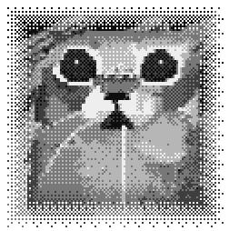

<div align="center">

<picture>
  <source media="(prefers-color-scheme: dark)" srcset="banner-dark.gif">
  <source media="(prefers-color-scheme: light)" srcset="banner-light.gif">
  
</picture>

<br/>

<picture>
  <source media="(prefers-color-scheme: dark)" srcset="https://readme-typing-svg.demolab.com?font=Jacquard+24&size=44&duration=2400&pause=999999&color=E6EDF3&center=true&vCenter=true&repeat=false&width=520&height=64&lines=hi%2C+i%27m+delux">
  
</picture>

**a quiet corner for unfinished things**


<br/>

<sub><i>The careful placement of earbuds and notebook speaks to a readiness for reflection — a preparation for the internal journey that music often facilitates. It's the quiet anticipation of inspiration.</i></sub>

</div>

<br/>

<h3 align="center">— about —</h3>



**Delux** — or Francko, if you know me.

I study industrial engineering in Coquimbo, Chile. This place isn't about that.

This is my private corner: half-finished ideas, things I build only for myself, and projects that aren't ready to see the light yet.

Off the clock you'll find me theorycrafting **Pokémon VGC** teams, or under a barbell — **bench · squat · deadlift**.

Someday some of this will be public. Not yet.

<br clear="right"/>

<h3 align="center">— archive —</h3>

```text
~/dxlux
 ├── private/     [##########]   sealed
 ├── wip/         [#####.....]   in progress
 └── public/      [..........]   not yet
```

<h3 align="center">— find me —</h3>

<p align="center">
  <a href="https://www.instagram.com/un.hxly._"></a>
  &nbsp;
  <a href="https://mail.google.com/mail/?view=cm&to=francko.thenoux@gmail.com"></a>
</p>

<h3 align="center">— tools —</h3>

<p align="center">
  
</p>

<h3 align="center">— activity —</h3>

<p align="center">
  
</p>

<br/>

<p align="center"><sub><i>❝ In stillness, the architecture of thought emerges. ❞</i></sub></p>
